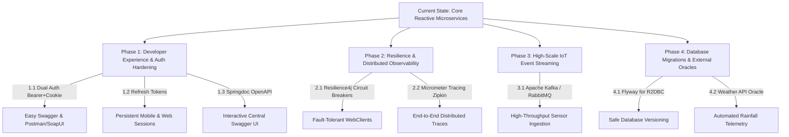
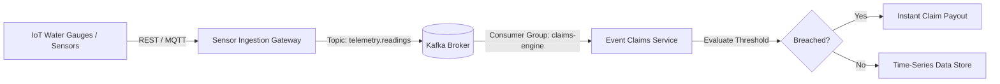

# IrrigaShield: Backend Architecture Improvements & Future Roadmap

This document outlines high-impact architectural and engineering enhancements for the **IrrigaShield** backend. Once your frontend is complete, you can use this blueprint to upgrade the platform to production-grade enterprise standards.

---

## Roadmap Summary



---

## 1. Dual Authentication: Cookie + Bearer Token Support

### 1.1 The Current Limitation
[`JwtAuthenticationFilter.java`](file:///c:/TRAINING/Capstone-IrrigaSheild/api-gateway/src/main/java/org/example/apigateway/filter/JwtAuthenticationFilter.java) only extracts the token from the `IRRIGASHIELD_TOKEN` cookie. While secure against XSS for browser clients, it complicates:
- Swagger UI / OpenAPI testing.
- Mobile client integration (Android / iOS / Flutter).
- Automation scripts and testing tools (Postman, SoapUI, cURL).

### 1.2 The Implementation Blueprint
Update `api-gateway` to inspect the `Authorization: Bearer <token>` header first. If absent, fall back to the `IRRIGASHIELD_TOKEN` cookie.

#### Code Change in `api-gateway`:
```java
// File: api-gateway/.../filter/JwtAuthenticationFilter.java

private String resolveToken(ServerWebExchange exchange) {
    // 1. Check Authorization: Bearer header
    String authHeader = exchange.getRequest()
            .getHeaders()
            .getFirst(HttpHeaders.AUTHORIZATION);

    if (authHeader != null && authHeader.startsWith("Bearer ")) {
        return authHeader.substring(7);
    }

    // 2. Fall back to Cookie
    HttpCookie jwtCookie = exchange.getRequest()
            .getCookies()
            .getFirst(cookieName);

    if (jwtCookie != null && !jwtCookie.getValue().isBlank()) {
        return jwtCookie.getValue();
    }

    return null;
}
```

---

## 2. Refresh Token Rotation Mechanism

### 2.1 The Current Limitation
Access tokens currently expire in 1 hour (`expiration-ms: 3600000`). When expired, users are unceremoniously logged out and forced to re-enter their credentials.

### 2.2 The Implementation Blueprint
Implement short-lived access tokens (15 minutes) paired with a persistent, revocable refresh token (7–30 days) stored in the database.

#### Schema Addition (`auth-service/src/main/resources/schema.sql`):
```sql
CREATE TABLE IF NOT EXISTS refresh_tokens (
    token_id BIGINT NOT NULL AUTO_INCREMENT,
    user_id BIGINT NOT NULL,
    token_hash VARCHAR(255) NOT NULL,
    expires_at TIMESTAMP NOT NULL,
    revoked BOOLEAN NOT NULL DEFAULT FALSE,
    created_at TIMESTAMP NOT NULL DEFAULT CURRENT_TIMESTAMP,

    CONSTRAINT pk_refresh_tokens PRIMARY KEY (token_id),
    CONSTRAINT uk_refresh_tokens_hash UNIQUE (token_hash),
    CONSTRAINT fk_refresh_tokens_user FOREIGN KEY (user_id) REFERENCES users (user_id),
    INDEX idx_refresh_tokens_user (user_id)
);
```

#### New Endpoint in `AuthController.java`:
- `POST /api/auth/refresh`
  - Validates refresh token from cookie or payload.
  - Revokes old refresh token and issues a new pair (Refresh Token Rotation pattern).

---

## 3. High-Scale IoT Telemetry Streaming (Apache Kafka / RabbitMQ)

### 3.1 The Current Limitation
Telemetry readings from water gauges and pumps currently arrive via synchronous REST `POST /api/readings`.
If 10,000 farm sensors broadcast telemetry every 5 minutes, synchronous HTTP creates connection pool exhaustion and database lock contention.

### 3.2 The Implementation Blueprint
Decouple sensor ingestion from parametric claim processing using **Apache Kafka** or **RabbitMQ** with Spring Cloud Stream Reactive.



#### Maven Dependencies (`event-claims-service/pom.xml`):
```xml
<dependency>
    <groupId>org.springframework.cloud</groupId>
    <artifactId>spring-cloud-stream-binder-kafka</artifactId>
</dependency>
```

#### Stream Consumer in `event-claims-service`:
```java
@Configuration
public class TelemetryStreamConfig {

    @Bean
    public Consumer<Flux<IrrigationReadingMessage>> processTelemetry(EventClaimsService claimsService) {
        return flux -> flux
            .concatMap(reading -> claimsService.processReadingAsync(reading))
            .subscribe();
    }
}
```

---

## 4. Inter-Service Fault Tolerance with Resilience4j

### 4.1 The Current Limitation
In `policy-service`, `FarmServiceClient` calls `FARM-SERVICE` over HTTP. If `FARM-SERVICE` encounters network latency, restarts, or crashes:
- `policy-service` requests hang until timeout.
- User receives raw 503 errors.

### 4.2 The Implementation Blueprint
Add **Resilience4j Circuit Breakers**, **Rate Limiters**, and **Retries** with fallback methods to protect inter-service communications.

#### Maven Dependency:
```xml
<dependency>
    <groupId>io.github.resilience4j</groupId>
    <artifactId>resilience4j-spring-boot3</artifactId>
</dependency>
<dependency>
    <groupId>io.github.resilience4j</groupId>
    <artifactId>resilience4j-reactor</artifactId>
</dependency>
```

#### Code Enhancement in `FarmServiceClient.java`:
```java
@CircuitBreaker(name = "farmServiceCircuitBreaker", fallbackMethod = "getFarmRiskProfileFallback")
@Retry(name = "farmServiceRetry")
public Mono<FarmRiskProfileResponse> getFarmRiskProfile(AuthenticatedUser underwriter, Long farmId) {
    return webClient.get()
        .uri("/api/farms/{farmId}/risk-profile", farmId)
        ...
        .bodyToMono(FarmRiskProfileResponse.class);
}

// Graceful fallback when farm-service is down
public Mono<FarmRiskProfileResponse> getFarmRiskProfileFallback(
        AuthenticatedUser underwriter, Long farmId, Throwable ex) {
    log.warn("Farm-service unavailable for farmId {}. Error: {}", farmId, ex.getMessage());
    return Mono.error(new ApiException(
        HttpStatus.SERVICE_UNAVAILABLE,
        "FARM_SERVICE_TEMPORARILY_OFFLINE",
        "Farm service is temporarily unavailable. Please try your assessment again in a moment."
    ));
}
```

---

## 5. Distributed Tracing & Centralized Observability

### 5.1 The Current Limitation
When an error occurs during an underwriting assessment, you have to search individual console logs across `api-gateway`, `policy-service`, and `farm-service` separately. There is no unified correlation identifier.

### 5.2 The Implementation Blueprint
Adopt **Micrometer Tracing** with **Zipkin** or **OpenTelemetry**. Every incoming request to `api-gateway` receives a unique `traceId` which is automatically propagated through all downstream microservice calls.

#### Dependencies for all services:
```xml
<dependency>
    <groupId>io.micrometer</groupId>
    <artifactId>micrometer-tracing-bridge-brave</artifactId>
</dependency>
<dependency>
    <groupId>io.zipkin.reporter2</groupId>
    <artifactId>zipkin-reporter-brave</artifactId>
</dependency>
```

#### Configuration (`application.yaml`):
```yaml
management:
  tracing:
    sampling:
      probability: 1.0  # Trace 100% of requests in dev
  zipkin:
    tracing:
      endpoint: http://localhost:9411/api/v2/spans
logging:
  pattern:
    level: "%5p [${spring.application.name:},%X{traceId:-},%X{spanId:-}]"
```

Logs will automatically display the trace ID:
```
INFO [policy-service,65a7df83c9a1b4d0,65a7df83c9a1b4d0] - Starting underwriting review for app 1
INFO [farm-service,65a7df83c9a1b4d0,b873c9120aef100a] - Serving risk profile for farm 1
```

---

## 6. Centralized Interactive Swagger UI (Springdoc OpenAPI)

### 6.1 The Implementation Blueprint
Add Swagger/OpenAPI support so anyone testing the backend can open `http://localhost:8080/swagger-ui.html` and execute all endpoints interactively with auto-generated documentation.

#### In `api-gateway/pom.xml`:
```xml
<dependency>
    <groupId>org.springdoc</groupId>
    <artifactId>springdoc-openapi-starter-webflux-ui</artifactId>
    <version>2.5.0</version>
</dependency>
```

#### Route Aggregation in `api-gateway/src/main/resources/application.yaml`:
```yaml
springdoc:
  swagger-ui:
    urls:
      - name: Auth Service
        url: /api/auth/v3/api-docs
      - name: Farm Service
        url: /api/farms/v3/api-docs
      - name: Policy Service
        url: /api/plans/v3/api-docs
      - name: Event & Claims Service
        url: /api/claims/v3/api-docs
```

---

## 7. Version-Controlled Database Migrations (Flyway for R2DBC)

### 7.1 The Current Limitation
Each service uses `spring.sql.init.mode: always` with raw `schema.sql`. In a production release or staging database, re-running `schema.sql` can overwrite columns or fail on table alterations.

### 7.2 The Implementation Blueprint
Adopt **Flyway R2DBC** to manage incremental, version-controlled SQL migration scripts:
```
src/main/resources/db/migration/
  ├── V1__create_users_table.sql
  ├── V2__add_phone_number_index.sql
  └── V3__create_refresh_tokens_table.sql
```

---

## 8. External Oracle: Weather API Integration

### 8.1 The Vision
Instead of relying solely on simulated telemetry from `DATA_PROVIDER` accounts, integrate an automated **External Weather Data Oracle** (e.g. OpenWeatherMap, NASA POWER, or India Meteorological Department APIs).

### 8.2 Architectural Flow
```
[Scheduled Cron @ 02:00 AM] 
       │
       ▼
[Weather Oracle Worker in event-claims-service]
       │
       ├─► Fetches farm GPS coordinates (latitude, longitude) from Farm Service
       ├─► Queries OpenWeatherMap 5-Day Rainfall History
       ├─► Calculates rolling dry-spell days & soil moisture deficit
       └─► Publishes IrrigationReading to trigger parametric claims automatically!
```

---

## Priority Order for Future Development

When you are ready to tackle the backend after frontend development, this is the recommended execution sequence:

1. **Step 1 (Day 1)**: Implement **Dual Auth (Bearer + Cookie)** — this takes < 30 minutes and instantly improves testability.
2. **Step 2 (Day 2)**: Add **Springdoc OpenAPI / Swagger UI** — gives you interactive web documentation for all services.
3. **Step 3 (Day 3-4)**: Add **Resilience4j Circuit Breakers** to `WebClient` inter-service calls.
4. **Step 4 (Week 2)**: Set up **Kafka** for IoT telemetry streaming.
5. **Step 5 (Week 3)**: Implement the **External Weather API Oracle**.
